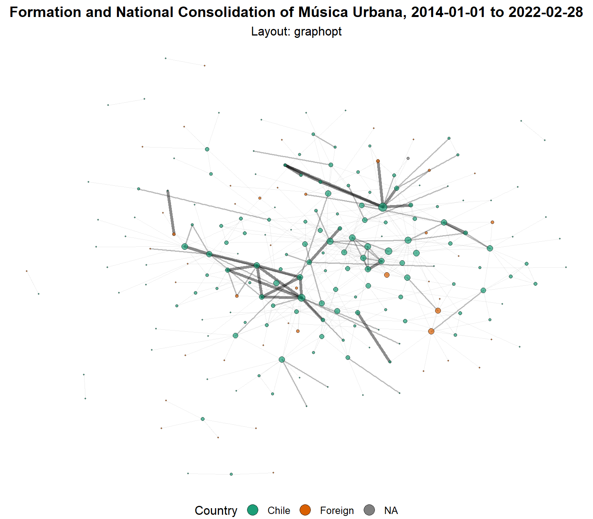
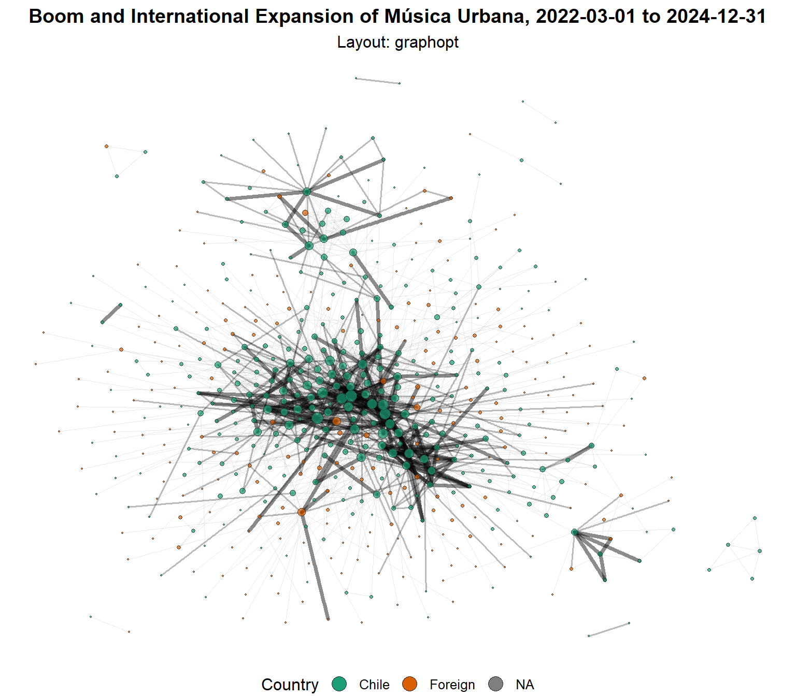
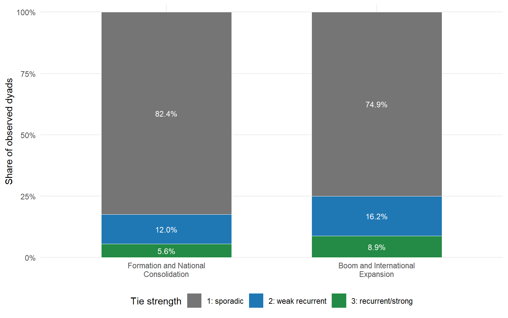
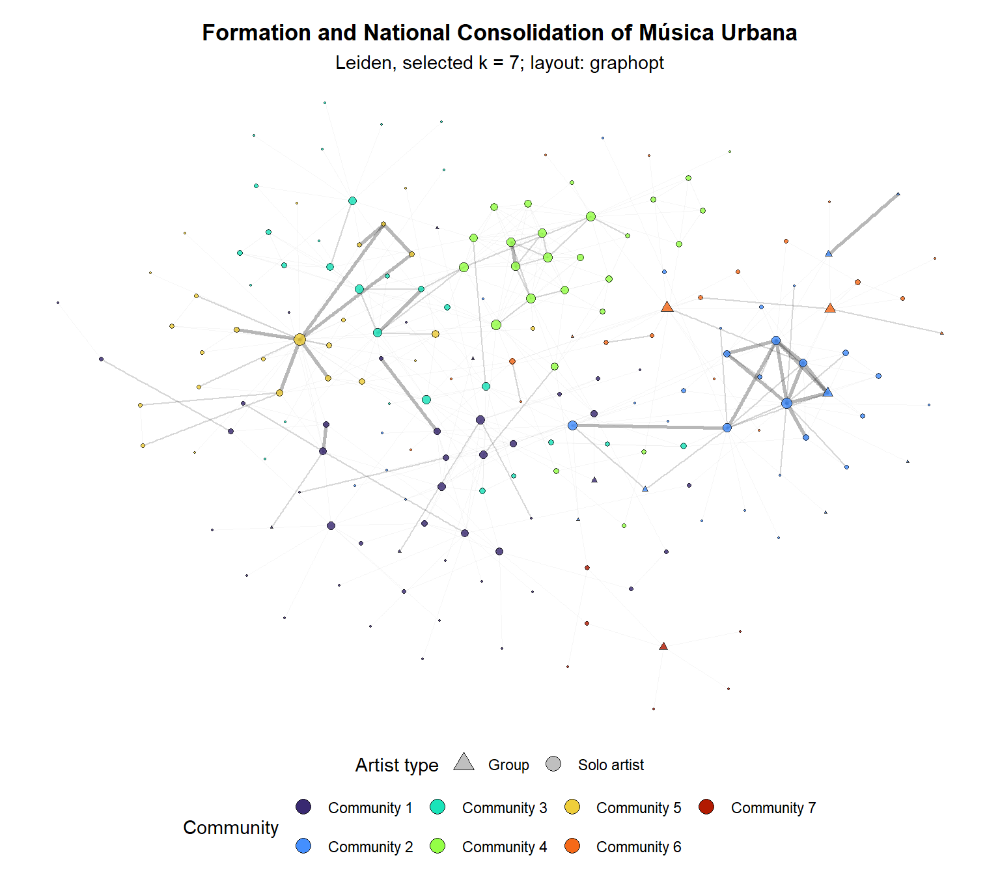
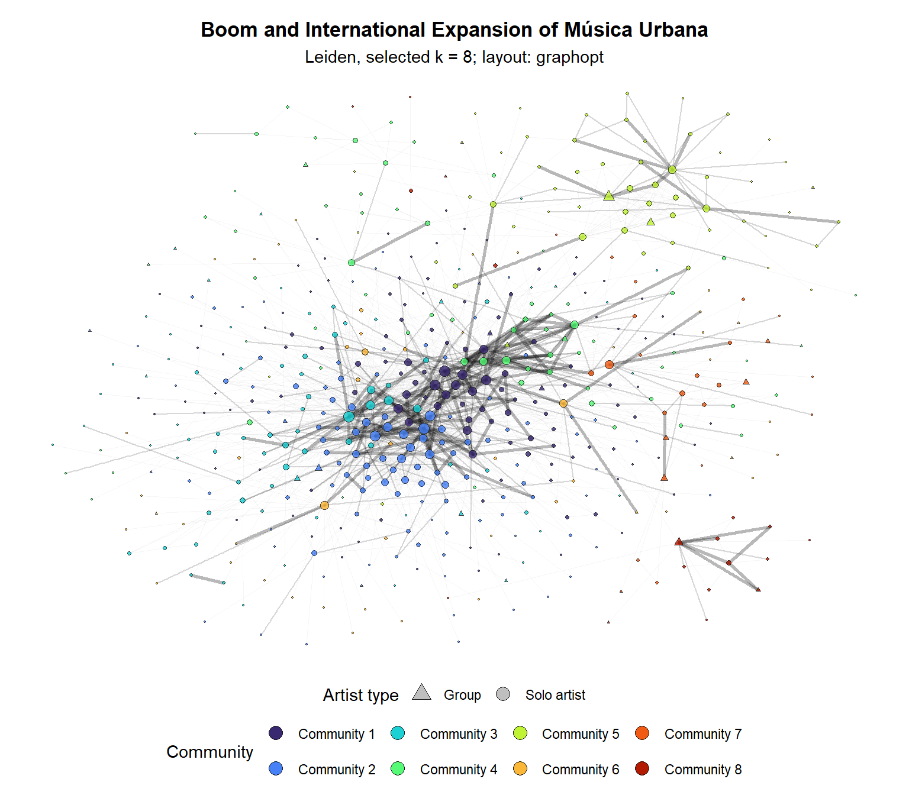
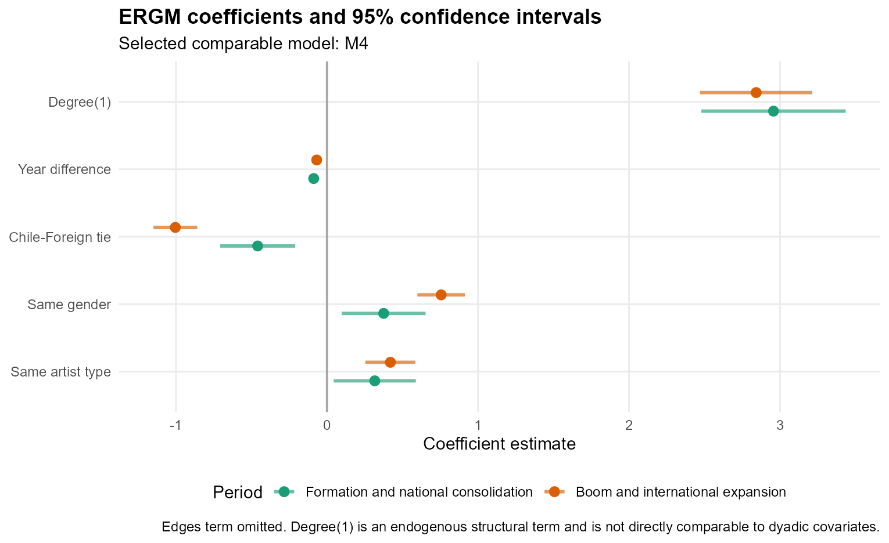
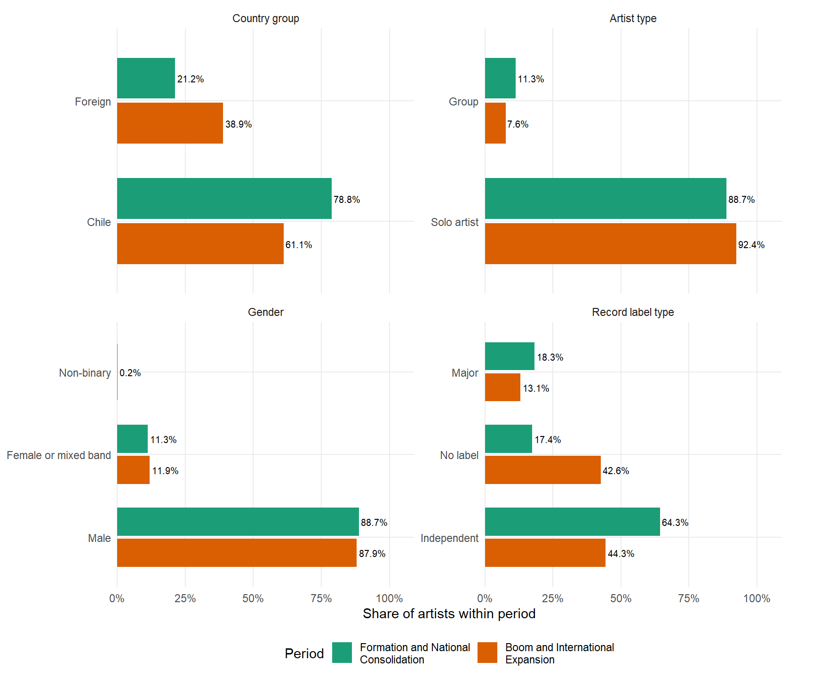
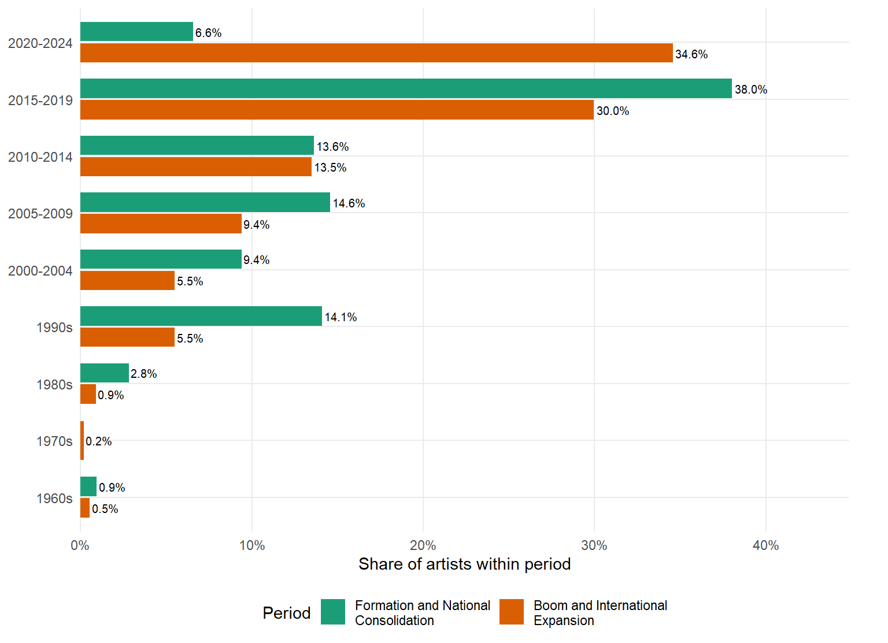

<!-- Exposición: 31 diapositivas, 20 minutos. Referencias y respaldo fuera del tiempo.
Identificación y proyecto del expositor en la segunda diapositiva.
Citas y referencias basadas en el PDF proporcionado. -->

<style>
.reveal { font-family: "Segoe UI", Arial, sans-serif; font-size: 31px; color: #22332d; }
.reveal h1 { font-size: 1.95em; }
.reveal h2 { font-size: 1.38em; color: #173e32; margin-bottom: 0.65em; }
.reveal .subtitle { font-size: 0.85em; }
.reveal li { margin-bottom: 0.5em; }
.reveal table { font-size: 0.83em; }
.reveal table td, .reveal table th { padding: 0.3em 0.5em; }
.reveal .columns { gap: 1.1em; }
.reveal .compacto { font-size: 0.76em; }
.reveal section.grafico { text-align: center; }
.reveal section.grafico h2 { font-size: 1.16em; margin-bottom: 0.2em; }
.reveal section.grafico > p { margin: 0; }
.reveal section.grafico img {
  display: block;
  margin: 0 auto;
  width: auto;
  height: 560px;
  max-height: 560px;
  max-width: 100%;
  object-fit: contain;
}
.reveal section.grafico .compacto {
  font-size: 0.65em;
  line-height: 1.2;
  margin-top: 0.2em;
}
.reveal section.grafico .compacto p { margin: 0; }
.reveal .referencias { font-size: 0.62em; }
.reveal .referencias p { margin-bottom: 0.8em; }
.reveal strong { color: #12634d; }
</style>

::: {.notes}
**0:20 · acumulado 0:20.**

Esta presentación examina cómo se organizó la música urbana chilena a través de colaboraciones acreditadas en Spotify entre 2014 y 2024. La pregunta surge de una aparente paradoja: una misma categoría reúne trayectorias y sonidos muy diferentes. Propongo mirar las relaciones entre artistas para comprender qué conecta ese mundo y qué diferencias persisten en su interior.
:::

## Autoría y proyecto

**Sebastian Matías Muñoz Tapia**

ANID · Universidad Alberto Hurtado · CMUS

**Fondecyt de Iniciación N.º 11260379**

“Nuevas configuraciones de clase y género en la música urbana chilena: una sociología del gusto generacional”

[sebastianmunozt@gmail.com](mailto:sebastianmunozt@gmail.com)

::: {.notes}
**0:15 · acumulado 0:35.**

Presentar autoría, afiliación y financiamiento: Sebastian Matías Muñoz Tapia, ANID, Universidad Alberto Hurtado y CMUS. Esta investigación se vincula al Fondecyt de Iniciación N.º 11260379, “Nuevas configuraciones de clase y género en la música urbana chilena: una sociología del gusto generacional”. Contacto: sebastianmunozt@gmail.com.
:::

## Música urbana: una categoría controversial

- La categoría reúne reggaetón, trap, dembow, mambo chileno, RKT y rap, con fronteras variables (Muñoz-Tapia, Arias Salvado y Hammou, 2025).
- En Chile, el rap histórico vinculado al hip hop y al boom bap suele distinguirse de lo reconocido como **urbano** (Muñoz-Tapia y Pinochet-Cobos, 2025).
- Su delimitación implica disputas de pertenencia, generación y legitimidad.

::: {.notes}
**0:45 · acumulado 1:20.**

El problema de partida es la controversia: quién entra en la categoría y cómo se nombran las diferencias. La delimitación analítica amplia incorpora rap, pero esto no implica que todos los artistas se identifiquen como urbanos. En el caso chileno, las trayectorias históricas del rap se distinguen con frecuencia de las nuevas formaciones urbanas. Se trata de fronteras históricas y discutidas, no de una separación absoluta ni de ausencia de intercambios (Muñoz-Tapia y Pinochet-Cobos, 2025).
:::

## Música urbana como hipergénero

- Un **hipergénero** agrupa géneros y prácticas heterogéneas bajo una clasificación amplia (Buch, 2013, 2018).
- Su coherencia puede descansar en circuitos, públicos e infraestructuras compartidas, aun con diferencias sonoras.
- Música urbana articula variantes locales y transnacionales como un **hipergénero glocal** (Muñoz-Tapia, Arias Salvado y Hammou, 2025).

::: {.notes}
**0:45 · acumulado 2:05.**

El hipergénero permite comprender la escala de la clasificación. Rap, trap y reggaetón conservan convenciones e historias propias, mientras una categoría más amplia los conecta de manera variable. Glocal señala que las conexiones transnacionales se traducen y reorganizan en contextos locales. Por eso música urbana no significa exactamente lo mismo en Chile que urban music en Estados Unidos. La controversia sobre el rap es parte de este proceso de articulación, no una anomalía que debamos borrar (Buch, 2013, 2018; Muñoz-Tapia, Arias Salvado y Hammou, 2025).
:::

## Pregunta central: coherencia y estabilización

**¿Cómo adquiere coherencia y se estabiliza una formación musical tan heterogénea?**

Estudiamos esa estabilización a través de las **colaboraciones entre artistas**.

- ¿Cómo se expande e integra la red?
- ¿Qué fronteras generacionales e internacionales persisten?
- ¿Cómo se distribuye la participación?

::: {.notes}
**0:45 · acumulado 2:50.**

La pregunta central vincula heterogeneidad y estabilización. Buscamos entender cómo una formación musical controversial adquiere continuidad mediante relaciones observables. La estabilización se examina a través de la integración de la red, la recurrencia de colaboraciones y la organización de agrupamientos diferenciados. Es una interpretación de conjunto: ninguna medida aislada prueba la estabilización de una categoría. Tampoco afirmamos que las colaboraciones sean su único mecanismo.
:::

## Géneros como procesos de categorización

- Los géneros se producen al **poner nombre a músicas, músicos y públicos**, agrupándolos y diferenciándolos históricamente (Brackett, 2016).
- Esas clasificaciones generan expectativas sobre sonidos, prácticas y pertenencias. Sus fronteras se negocian y disputan (Brackett, 2016; Drott, 2013).
- La categorización se articula con **redes e identidades**: orienta afinidades y las relaciones pueden reforzar o transformar sus significados (Born, 2011; White, 2008; Crossley, 2025a).

::: {.notes}
**0:55 · acumulado 3:45.**

Entendemos los géneros como procesos de categorización. Poner nombre a músicas, músicos y públicos permite reconocer afinidades, establecer diferencias y organizar expectativas. Es un proceso histórico en el que participan artistas, públicos, medios, industria y plataformas (Brackett, 2016). Las convenciones son parte de ese proceso: cambian con la circulación y la disputa sobre qué pertenece a cada género (Drott, 2013).

Las categorías también ofrecen posiciones de identificación. Nombrar a alguien como rapero o artista urbano puede orientar expectativas sobre sus públicos y colaboradores. Las redes son los canales donde esas identificaciones circulan y se ponen en práctica, y las relaciones pueden a su vez modificar las fronteras categoriales (Born, 2011; White, 2008; Crossley, 2025a).
:::

## Colaboraciones y estabilización de un mundo musical

- La producción musical descansa en **cooperación y convenciones** (Becker, 2008).
- Los mundos musicales adquieren continuidad mediante relaciones y prácticas recurrentes (Crossley, 2020).
- Las categorías orientan afinidades y las relaciones pueden reforzar o modificar pertenencias (White, 2008; Crossley, 2025a).

**Observamos una dimensión relacional de la estabilización.**

::: {.notes}
**0:45 · acumulado 4:30.**

Las colaboraciones acreditadas permiten seguir una capa de cooperación pública y acumulativa. Su repetición y distribución muestran continuidades y fronteras dentro del mundo musical. Las pertenencias categoriales pueden orientar con quién resulta legítimo o deseable colaborar, mientras los vínculos reiterados pueden reforzar esas pertenencias. El análisis observa patrones compatibles con esa articulación sin probar la dirección causal entre clasificación y colaboración (White, 2008; Crossley, 2025a).
:::

## SNA: análisis de redes sociales

- El **análisis de redes sociales**, o **SNA** por sus siglas en inglés, estudia actores, vínculos y sus configuraciones.
- Permite analizar posiciones centrales y periféricas, integración, agrupamientos y patrones de asociación.
- En el estudio de mundos musicales, complementa la historia con evidencia sobre **quién coopera con quién y cómo se organiza esa cooperación** (Crossley, 2020, 2025a).

Aquí combinamos **descriptivos, comunidades y ERGM**.

::: {.notes}
**0:45 · acumulado 5:15.**

SNA significa Social Network Analysis, en español análisis de redes sociales. Su objeto son relaciones entre actores y las estructuras que forman. Aquí no se refiere específicamente a redes sociales digitales como Instagram. En la perspectiva de mundos musicales, permite examinar las relaciones que sostienen producción y circulación, en diálogo con la interpretación histórica (Crossley, 2020). Los descriptivos resumen el conjunto, las comunidades identifican agrupamientos y los ERGM evalúan asociaciones condicionales entre atributos, estructura y existencia de vínculos.
:::

## Dos períodos de observación

| Formación y consolidación nacional | Boom y expansión internacional |
|:---|:---|
| Enero de 2014 a febrero de 2022 | Marzo de 2022 a diciembre de 2024 |
| Articulación de trayectorias y circuitos locales | Mayor escala y visibilidad transnacional |

**Redes independientes:** cada período conserva sus propias colaboraciones.

::: {.notes}
Procedencia de esta diapositiva: Documento base, secciones 3.3 y 4.5, pp. 15–16 y 20

**0:45 · acumulado 6:00.**

La comparación separa una etapa de formación y consolidación nacional de otra de boom y expansión internacional. La investigación utiliza marzo de 2022 como corte analítico, asociado a una transformación de escala y visibilidad que el texto ilustra con canciones como Una Noche en Medellín y Ultra Solo.

El corte no supone que antes no existieran vínculos internacionales ni que después desaparecieran los circuitos nacionales. Además, las redes no son acumulativas: una colaboración del primer período no se traslada automáticamente al segundo.

Es fundamental recordar que las ventanas tienen distinta duración. Por eso las cifras comparan tamaños y estructuras observadas. No constituyen tasas anuales ni identifican un efecto causal del boom. Las hipótesis plantean expansión e integración, mayor presencia internacional, más recurrencia y persistencia de una participación desigual.
:::

## Qué representa la red

```{=html}
<svg viewBox="0 0 1120 430" role="img" aria-labelledby="red-titulo red-desc" style="width:100%;height:430px;display:block;font-family:'Segoe UI',Arial,sans-serif">
<title id="red-titulo">Nodos, vínculos y peso de una red de colaboración</title>
<desc id="red-desc">Ejemplo ficticio: cada círculo es un artista. A y B comparten una canción, representada con una línea fina. A y C comparten cuatro canciones, representadas con una línea gruesa.</desc>
<g stroke="#12634d" stroke-linecap="round">
<line x1="160" y1="210" x2="500" y2="100" stroke-width="3"/>
<line x1="160" y1="210" x2="500" y2="325" stroke-width="16"/>
</g>
<g fill="#12634d" stroke="#faf9f6" stroke-width="4">
<circle cx="160" cy="210" r="43"/><circle cx="500" cy="100" r="43"/><circle cx="500" cy="325" r="43"/>
</g>
<g fill="white" text-anchor="middle" font-size="30" font-weight="600">
<text x="160" y="220">A</text><text x="500" y="110">B</text><text x="500" y="335">C</text>
</g>
<g fill="#22332d" font-size="25" text-anchor="middle">
<text x="160" y="285">Artista A</text><text x="500" y="40">Artista B</text><text x="500" y="400">Artista C</text>
<text x="315" y="120">1 canción</text><text x="310" y="325">4 canciones</text>
</g>
<g fill="#22332d" font-size="27">
<text x="650" y="90" fill="#12634d" font-weight="700">Nodo = artista</text>
<text x="650" y="125">Solista o agrupación.</text>
<text x="650" y="190" fill="#12634d" font-weight="700">Vínculo = colaboración</text>
<text x="650" y="225">Participación conjunta en una pista.</text>
<text x="650" y="290" fill="#12634d" font-weight="700">Más grosor = mayor peso</text>
<text x="650" y="325">Más pistas únicas compartidas</text>
<text x="650" y="360">por esa pareja de artistas.</text>
</g>
</svg>
```

::: {.compacto}
**Ejemplo ficticio.** Coparticipaciones acreditadas en Spotify. Núcleo chileno validado manualmente y colaboradores directos, con filtro de más de 1.000 seguidores.
:::

::: {.notes}
Procedencia de esta diapositiva: Documento base, secciones 4.1–4.5, pp. 16–20

**0:45 · acumulado 6:45.**

La extracción parte de playlists curadas y utiliza metadatos de Spotify. La delimitación combina etiquetas de la plataforma con revisión manual de trayectorias y pertenencias. Los artistas externos ingresan por su relación directa con el núcleo chileno seleccionado. La base validada aplica un umbral de más de mil seguidores y excluye perfiles organizacionales y cuentas redundantes.

Cuando una canción acredita a varios intérpretes, se generan las parejas correspondientes. Se depuran duplicados de pareja y pista. Una canción con varios participantes puede producir varios vínculos, por lo que la suma de colaboraciones entre parejas no equivale al número de canciones del corpus.

El análisis combina descripción, detección de comunidades y modelos de redes. La unidad observada es la coparticipación acreditada, que recoge solo una parte de la cooperación musical.
:::

## Red de formación y consolidación nacional {.grafico}

{height=560 fig-alt="Red de formación y consolidación nacional, 2014 a febrero de 2022"}

::: {.compacto}
La red reúne **213 artistas y 410 vínculos**. El componente mayor contiene al **89,7 %** de los artistas (disertación, 2026, tabla 2A).
:::

::: {.notes}
**0:35 · acumulado 7:20.**

La red de formación muestra una estructura de menor tamaño, con 213 artistas y 410 parejas colaboradoras. Verde identifica artistas chilenos y naranja artistas extranjeros. El tamaño de cada nodo representa su número de colaboradores y el grosor de las aristas la intensidad ordinal. Presentamos esta imagen como referencia para observar el cambio de escala en el siguiente período. Las posiciones espaciales responden al algoritmo de disposición y no son distancias geográficas.
:::

## Red del boom y expansión internacional {.grafico}

{height=560 fig-alt="Red del boom y expansión internacional, marzo de 2022 a diciembre de 2024"}

::: {.compacto}
La red llega a **564 artistas y 1.579 vínculos**. El componente mayor alcanza el **96,6 %** (disertación, 2026, tabla 2A).
:::

::: {.notes}
Procedencia de esta diapositiva: Documento base, tabla 2A, pp. 23–24

**0:35 · acumulado 7:55.**

El primer hallazgo es una expansión acompañada de integración. La red pasa de 213 a 564 artistas y de 410 a 1.579 parejas colaboradoras. El componente mayor, es decir, el conjunto dentro del cual los artistas están conectados directa o indirectamente, reúne al 96,6 por ciento de la segunda red.

La caída de densidad puede parecer contradictoria, pero mide otra cosa: la proporción de vínculos existentes respecto de todos los posibles. Al crecer la cantidad de artistas, también aumenta mucho el universo de parejas posibles. Por eso una red puede integrar a una mayor proporción de participantes y, al mismo tiempo, realizar una fracción menor de sus vínculos potenciales. Esta distinción es central para interpretar el crecimiento.
:::

## La integración conserva una periferia amplia

| Colaboradores por artista | Formación | Boom |
|:---|---:|---:|
| Promedio | 3,85 | 5,60 |
| Mediana | 2 | 2 |
| Máximo | 27 | 55 |

**El promedio aumenta, pero la mitad de los artistas tiene como máximo dos colaboradores.**

::: {.notes}
Procedencia de esta diapositiva: Documento base, tabla 2B y discusión, pp. 23–24 y 55

**0:45 · acumulado 8:40.**

La expansión no distribuye de manera uniforme la participación. El promedio de colaboradores aumenta, pero la mediana permanece en dos y el máximo llega a 55. La distancia entre la experiencia típica y la de los artistas más conectados sigue siendo relevante.

Esto no significa que toda la red dependa cada vez más de una sola figura. De hecho, la centralización de grado disminuye de 0,110 a 0,088. Podemos hablar de heterogeneidad persistente y de una periferia amplia sin afirmar una concentración creciente en un único centro.

Tener pocos vínculos tampoco demuestra exclusión deliberada, precariedad o falta de éxito. El resultado describe una forma de inserción en esta capa particular de colaboraciones.
:::

## Aumentan las colaboraciones recurrentes {.grafico}

{height=560 fig-alt="Distribución de parejas por número de colaboraciones en ambos períodos"}

::: {.compacto}
Las parejas con **dos o más pistas** pasan del **17,6 % al 25,1 %**. Predominan los vínculos de una sola pista (disertación, 2026, figura 5).
:::

::: {.notes}
Procedencia de esta diapositiva: Documento base, sección 5.1.3 y figura 5, p. 29

**0:35 · acumulado 9:15.**

El peso permite distinguir la existencia de una colaboración de su repetición. Las parejas que comparten al menos dos pistas pasan del 17,6 al 25,1 por ciento. Dentro de ese conjunto, las que comparten tres o más aumentan del 5,6 al 8,9 por ciento. Son categorías anidadas, por lo que no corresponde sumar ambos porcentajes.

También cambia la cohesión: la transitividad binaria disminuye, mientras la ponderada aumenta. Esto sugiere mayor intensidad en las configuraciones locales cerradas que permanecen. En conjunto, los resultados muestran continuidad colaborativa en un sector de la red, aunque el vínculo ocasional sigue dominando.
:::

## Conclusiones de los descriptivos

- **Integración:** más artistas forman parte de una estructura conectada.
- **Continuidad:** aumenta la proporción de colaboraciones recurrentes.
- **Desigualdad:** la participación típica sigue siendo reducida, con mediana de dos colaboradores.

La estabilización relacional combina **integración y recurrencia**, conservando diferencias de participación (disertación, 2026, pp. 23–30).

::: {.notes}
**0:30 · acumulado 9:45.**

Los descriptivos muestran crecimiento con mayor integración y más recurrencia. Esta combinación aporta indicios de continuidad del espacio colaborativo, mientras la mediana estable y la periferia impiden equiparar consolidación con participación homogénea. El crecimiento corresponde al campo visible en Spotify y las ventanas tienen distinta duración. Estas cautelas delimitan lo que podemos afirmar sobre estabilización.
:::

## Comunidades: qué hace el método Leiden

- Una comunidad reúne artistas con **más peso de colaboración interno del esperado según su conectividad**.
- Leiden busca una partición que optimice la **modularidad ponderada** del componente mayor.
- Utilizamos pesos ordinales: **una, dos y tres o más pistas**.
- Comparamos resoluciones y ejecuciones, y contrastamos con Louvain: ajuste, estabilidad, tamaños e interpretación (disertación, 2026, pp. 30–34).

::: {.notes}
**1:05 · acumulado 10:50.**

La técnica distribuye artistas en grupos y evalúa si el peso de sus conexiones internas supera un patrón de referencia que considera su conectividad ponderada. Esa comparación se resume en la modularidad. El parámetro de resolución cambia el nivel de detalle de la partición, por lo que no fijamos el número de grupos de antemano. Repetimos ejecuciones y comparamos alternativas para evitar depender de una sola solución. Leiden favorece comunidades internamente conectadas y Louvain aporta un contraste. Una comunidad matemática no equivale automáticamente a un género ni demuestra una identidad reconocida por los propios artistas.
:::

## Comunidades durante la formación {.grafico}

{height=560 fig-alt="Siete comunidades Leiden durante la formación"}

::: {.compacto}
La partición identifica **siete comunidades**. La diferenciación relacional dialoga con las divisiones generacionales de la escena (Muñoz-Tapia y Pinochet-Cobos, 2025).
:::

::: {.notes}
**0:35 · acumulado 11:25.**

La partición del primer período identifica siete comunidades. Los colores distinguen los agrupamientos, el tamaño de nodo representa grado y las formas distinguen grupos y solistas, según la leyenda del gráfico. La partición utiliza el componente mayor y pesos ordinales de colaboración. Su selección combina modularidad, estabilidad e interpretación. Las diferencias entre rap histórico y agrupamientos urbanos más recientes requieren una lectura histórica y contextual (Muñoz-Tapia y Pinochet-Cobos, 2025).
:::

## Comunidades durante el boom {.grafico}

{height=560 fig-alt="Ocho comunidades Leiden durante el boom"}

::: {.compacto}
La partición identifica **ocho comunidades** dentro de una red mayor. Los números y colores son específicos de cada período (disertación, 2026, sección 5.2).
:::

::: {.notes}
Procedencia de esta diapositiva: Documento base, secciones 4.4 y 5.2, pp. 19 y 30–41 · Muñoz-Tapia y Pinochet-Cobos (2025)

**0:35 · acumulado 12:00.**

Las comunidades permiten observar cómo se organiza internamente una red cada vez más conectada. El análisis utiliza el componente mayor y pesos ordinales de colaboración. La elección de siete y ocho comunidades combina modularidad, estabilidad, equilibrio de tamaños e interpretación. No se trata de divisiones únicas o definitivas.

El resultado más relevante para la discusión musicológica es la persistencia de agrupamientos asociados a trayectorias históricas del rap junto a otros vinculados con cohortes urbanas más recientes. La variable generación utiliza el comienzo de la trayectoria profesional, con la primera publicación en Spotify como aproximación cuando falta información.

La lectura histórica depende del diálogo con Muñoz-Tapia y Pinochet-Cobos (2025). Un algoritmo puede identificar un agrupamiento, pero no establece por sí mismo que se trate de rap histórico o de un circuito urbano particular. Esa interpretación requiere conocimiento de los artistas y del contexto.
:::

## Comunidades: comparación entre períodos

::: {.compacto}
| Dimensión | P1: formación | P2: boom |
|:---|:---|:---|
| Partición Leiden | 7 comunidades, 191 artistas | 8 comunidades, 545 artistas |
| Rap | C2 y C6: predominan inicios en los años 1990 | C5: rap histórico; C8: cohorte dominante 2005–2009 |
| Urbano reciente | Predominan inicios entre 2015 y 2019 | C1, C2, C3 y C6: predominan inicios entre 2020 y 2024 |
| Lectura | Diferenciación generacional visible | Mayor escala, con diferencias internas persistentes |

La comparación es de **perfiles y configuraciones**, no de grupos idénticos seguidos en el tiempo (disertación, 2026, pp. 33–41).
:::

::: {.notes}
**0:35 · acumulado 12:35.**

La comparación se realiza dentro del componente mayor de cada red: 191 y 545 artistas. El primer período identifica siete comunidades y el segundo ocho. Las comunidades del segundo período tienen entre 18 y 129 artistas, frente a entre siete y 46 en el primero.

En P1, C2 y C6 reúnen perfiles de rap histórico, mientras gran parte de las otras comunidades tiene una cohorte dominante de inicio entre 2015 y 2019. En P2, el rap sigue visible en C5 y C8, con diferencias generacionales internas, y varias comunidades urbanas tienen predominio de inicios entre 2020 y 2024. Esto muestra persistencia y reorganización de perfiles, no una correspondencia directa entre sus miembros. Las cohortes indican inicio profesional, no edad biológica (disertación, 2026, secciones 5.2.1–5.2.4).
:::

## Comunidades: apertura internacional y articulaciones locales

::: {.compacto}
| Dimensión | P1: formación | P2: boom |
|:---|:---|:---|
| Articulación internacional | C5: Pablo Chill-E y Julianno Sosa, conexiones transnacionales tempranas | C1: 62 % extranjeros; C6: 90 %, con fuerte conexión a circuitos argentinos |
| Colaboración recurrente | C4: destaca la intensidad en reggaetón y mambo | C2: mayor intensidad media ordinal, con 117 artistas y 21 % extranjeros |
| Mujeres y grupos mixtos | C2: 27 %, con conexiones alrededor de Ana Tijoux | C4: 29 %, con AKRIILA, Shirel, SOULFIA y otras |

La expansión combina **núcleos internacionales y circuitos locales intensos** (disertación, 2026, pp. 37–40).
:::

::: {.notes}
**0:40 · acumulado 13:15.**

En el primer período ya aparecen conexiones internacionales, especialmente en la comunidad de Pablo Chill-E y Julianno Sosa. En el segundo, la apertura se organiza en al menos dos perfiles: C1 combina figuras chilenas con colaboradores de múltiples escenas, mientras C6 presenta el mayor porcentaje extranjero y conexiones particularmente visibles con circuitos argentinos.

Al mismo tiempo, C2 del boom tiene la mayor intensidad media ordinal y una composición más nacional. La internacionalización no reemplaza la recurrencia local. También varía la presencia de mujeres y agrupaciones mixtas: destaca C2 en P1, alrededor de Ana Tijoux, y C4 en P2. Esta comparación no demuestra que una comunidad haya migrado a otra. Compara perfiles situados en particiones independientes (disertación, 2026, tablas 5A–5B e interpretación).
:::

## Conclusiones de las comunidades

- La red pasa de siete a ocho comunidades en un componente mayor mucho más amplio.
- Persiste la diferenciación entre rap y urbano, con nuevas cohortes y configuraciones.
- La apertura internacional convive con circuitos nacionales de colaboración intensa.

El hipergénero articula diferencias **sin suprimir sus fronteras internas** (Muñoz-Tapia y Pinochet-Cobos, 2025; Muñoz-Tapia, Arias Salvado y Hammou, 2025).

::: {.notes}
**0:30 · acumulado 13:45.**

Las comunidades muestran una estabilización diferenciada: la categoría conecta circuitos que no se vuelven equivalentes. La separación entre rap histórico y nuevas trayectorias urbanas adquiere una expresión relacional, aunque no es absoluta. La interpretación se apoya en la historia y las trayectorias, y no únicamente en colores del algoritmo. Los números de comunidad son específicos de cada período y no identifican una continuidad directa entre grupos.
:::

## La internacionalización es selectiva

- En la disertación (2026, pp. 28 y 51), la presencia extranjera sube del **21,2 % al 38,9 %**, pero el modelo conserva una asociación negativa para vínculos Chile–extranjero.
- La expansión internacional se concentra en comunidades específicas.
- Una mayor circulación musical puede coexistir con desigualdades persistentes (Hesmondhalgh, 2025).

::: {.notes}
Procedencia de esta diapositiva: Documento base, pp. 28, 39 y 51 · Hesmondhalgh (2025)

**0:30 · acumulado 14:15.**

Este es uno de los hallazgos centrales. La composición se internacionaliza claramente: la presencia extranjera casi se duplica en términos porcentuales. Sin embargo, composición y mezcla relacional son dimensiones diferentes. Puede haber muchos artistas extranjeros concentrados alrededor de determinados sectores sin que los vínculos transnacionales se generalicen.

Los ERGM encuentran una asociación negativa para las parejas Chile–extranjero frente a las parejas Chile–Chile, dentro del espacio de vínculos elegibles y considerando los términos del modelo. El signo es compatible con una internacionalización selectiva.

La ampliación de la circulación musical puede coexistir con desigualdades (Hesmondhalgh, 2025). Esta investigación no mide propiedad de plataformas ni poder algorítmico. Su aporte específico es mostrar una apertura internacional desigual en las relaciones observadas.
:::

## ERGM: qué queremos explicar

- Preguntamos **qué patrones se asocian con que dos artistas colaboren**, considerando atributos y estructura de la red.
- Para cada pareja elegible registramos **1 = al menos una colaboración** y **0 = ninguna** en el período.
- Estimamos una red por período. La frecuencia de colaboración queda en el análisis descriptivo.
- El ERGM contrasta la red observada con una distribución de redes posibles (Koskinen y Snijders, 2012).

::: {.notes}
**0:40 · acumulado 14:55.**

Después de describir la red y sus comunidades, preguntamos qué patrones siguen asociados con la existencia de un vínculo cuando se consideran conjuntamente. Utilizamos modelos exponenciales de grafos aleatorios, o ERGM. La unidad que se modela es la red completa, de modo que podemos incorporar dependencias entre vínculos mediante estadísticas estructurales (Koskinen y Snijders, 2012).

Aquí simplificamos cada pareja: uno si colaboró al menos una vez y cero si no. No estimamos cuántas canciones compartirá ni predecimos el futuro de su carrera. Ajustamos el modelo por separado en cada período, con el mismo conjunto de términos para facilitar una comparación cautelosa.
:::

## ERGM: construcción y selección del modelo

| Paso | Qué incorporamos |
|:---|:---|
| **M1** | Nivel general de vínculos y restricciones del diseño |
| **M2** | Diferencia entre años de inicio y vínculos Chile–extranjero |
| **M3** | Similitud de género y de tipo de artista |
| **M4** | Presencia de artistas con un único colaborador |

Seleccionamos **M4** por su mejor AIC y BIC en ambos períodos y evaluamos su ajuste mediante redes simuladas (disertación, 2026, pp. 43–50).

::: {.notes}
**0:40 · acumulado 15:35.**

Construimos los modelos por etapas para evaluar qué aporta cada bloque. M1 fija el nivel general de conectividad y respeta restricciones de la muestra. M2 añade distancia entre años de inicio y el contraste nacional. M3 incorpora semejanza de género y distingue solistas de agrupaciones. M4 añade una estadística que cuenta artistas con exactamente un colaborador.

M4 mejora AIC y BIC respecto de los anteriores en ambos períodos. Después simulamos redes bajo el modelo y comparamos su grado, distancias y vecinos compartidos con los datos observados. También revisamos las cadenas de estimación MCMC. La selección combina ajuste, estabilidad y una especificación comparable, sin asumir que el modelo representa toda la vida musical (disertación, 2026, secciones 5.3.2–5.3.4).
:::

## ERGM: cómo interpretar un coeficiente

- El coeficiente actúa sobre las **log-odds condicionales** de un vínculo: depende de la red y de los demás términos.
- Para un atributo de pareja, **exp(β)** expresa un multiplicador de odds, con el resto constante.
- Ejemplo del boom: **β = −1,00** para Chile–extranjero implica **exp(−1) ≈ 0,37** veces las odds de Chile–Chile.
- Esto equivale a un 63 % menos de **odds**, no de probabilidad (disertación, 2026, tabla 7B).

::: {.notes}
**1:10 · acumulado 16:45.**

Las odds son la razón entre la probabilidad de que exista el vínculo y la de que no exista. El coeficiente se interpreta condicionalmente: mantenemos los otros atributos y la configuración relevante del resto de la red. En un ERGM, cada estadística aporta su coeficiente multiplicado por el cambio que produciría agregar ese vínculo. Para el indicador Chile–extranjero, ese cambio es uno y podemos exponenciar directamente su coeficiente. El resultado de 0,37 expresa odds relativas, no una probabilidad de colaboración del 37 por ciento. La probabilidad requiere sumar todas las contribuciones del modelo y aplicar la transformación logística. El término de grado uno exige calcular cómo cambian los grados de ambos extremos y no admite esa lectura simple como atributo de pareja.
:::

## ERGM: lectura de los coeficientes {.grafico}

{height=560 fig-alt="Coeficientes ERGM M4 e intervalos de confianza del 95 por ciento para ambos períodos"}

::: {.compacto}
Los puntos son estimaciones y las líneas sus intervalos del 95 %. El cero marca ausencia de asociación para el término estimado. Verde: formación. Naranja: boom (disertación, 2026, figura 8).
:::

::: {.notes}
**0:35 · acumulado 17:20.**

Primero ubicamos el cero. Para los atributos de las parejas, un coeficiente negativo indica menor propensión condicional a colaborar al aumentar la variable o pertenecer al contraste indicado, considerando los demás términos. Un coeficiente positivo indica la asociación contraria. Los coeficientes no son porcentajes ni probabilidades directas.

La diferencia entre años de inicio es negativa: trayectorias más distantes en el tiempo se asocian con menos vínculos. El contraste Chile–extranjero también es negativo respecto de Chile–Chile. Mismo género y mismo tipo de artista muestran asociaciones positivas.

El término de grado uno requiere otra lectura: es una estadística de la red, no un atributo de la pareja. Su signo positivo favorece configuraciones con más artistas de un solo colaborador. No implica que tener un vínculo cause la formación de otro. Los intervalos ayudan a apreciar la incertidumbre, y la comparación entre colores es descriptiva, no una prueba formal de cambio entre períodos (disertación, 2026, pp. 46 y 51–52).
:::

## Conclusiones del ERGM

- **Proximidad generacional:** colaborar se asocia con trayectorias iniciadas en años cercanos.
- **Internacionalización selectiva:** los vínculos Chile–extranjero siguen siendo menos probables que los Chile–Chile, dentro del modelo.
- **Periferia persistente:** M4 representa mejor la abundancia de artistas con un solo colaborador.
- **Límite:** las simulaciones subestiman los vecinos compartidos. La cohesión local requiere otras evidencias (disertación, 2026, pp. 50–52).

::: {.notes}
**0:30 · acumulado 17:50.**

Los resultados complementan la descripción y las comunidades. La asociación con proximidad de trayectorias respalda la relevancia de la dimensión generacional. La mayor cantidad de extranjeros no equivale a mezcla transnacional uniforme: el contraste Chile–extranjero permanece negativo. El término de grado uno permite representar mejor una red que conserva numerosos participantes periféricos.

La comparación internacional está limitada al espacio elegible por diseño. Los artistas externos entran por sus vínculos con el núcleo chileno, y los vínculos extranjero–extranjero están restringidos. La especificación también contempla que las redes finales no tienen aislados.

El ajuste reproduce razonablemente patrones amplios de grado y distancias, pero subestima parejas con varios vecinos compartidos. Las alternativas para capturar esa estructura no ofrecen una solución estable y comparable en ambos períodos. Por eso interpretamos la cohesión junto a la transitividad ponderada y las comunidades. Estos resultados son asociaciones, no causas demostradas (disertación, 2026, secciones 5.3.4–5.3.6).
:::

## Género y participación localizada

- Los artistas masculinos representan cerca del **88 %** en ambos períodos.
- Las comunidades muestran presencias desiguales de mujeres y agrupaciones mixtas.
- Ana Tijoux articula conexiones relevantes en el segmento de rap histórico.
- La música participa en la materialización de identidades sociales (Born, 2011).

::: {.notes}
Procedencia de esta diapositiva: Documento base, pp. 28, 37, 39 y 55 · Born (2011)

**0:40 · acumulado 18:30.**

La expansión conserva una composición fuertemente masculinizada. La homofilia de género es positiva en los modelos, pero el predominio masculino exige cautela al interpretarla. El resultado no basta para identificar un mecanismo causal de exclusión.

La lectura por comunidades aporta un matiz: la presencia de mujeres y de agrupaciones mixtas se concentra de forma desigual. El texto destaca a Ana Tijoux y sus conexiones con mujeres, artistas extranjeros y trayectorias parcialmente externas al núcleo urbano. En el boom, otra comunidad incluye a Vlntna B, KYA, Shirel, AKRIILA, Cami y SOULFIA.

La relación entre música e identidades abre preguntas sobre las condiciones de participación que requieren investigación adicional (Born, 2011).
:::

## Alcance de los hallazgos

- Spotify registra una capa de relaciones acreditadas y visibles.
- El filtro de seguidores y la selección del núcleo delimitan quién aparece.
- Las ventanas desiguales y los cambios de cobertura limitan la comparación del crecimiento.
- Los modelos identifican asociaciones y tienen límites para representar la cohesión local.

::: {.notes}
Procedencia de esta diapositiva: Documento base, secciones 5.3.4–5.3.5 y 6.1, pp. 50–51 y 56–57

**0:30 · acumulado 19:00.**

Las conclusiones deben mantenerse dentro de la frontera empírica. Quedan fuera relaciones de amistad, intercambios informales, producción o composición sin crédito interpretativo y actuaciones en vivo. El umbral de seguidores también reduce la presencia de sectores menos visibles.

El crecimiento puede combinar expansión de la escena con cambios en distribución digital, cobertura de metadatos y acreditación. Por eso hablamos del campo de colaboración visible en Spotify. Los atributos combinan información de plataforma con búsqueda asistida y revisión manual, lo que introduce decisiones interpretativas.

Estas limitaciones favorecen una agenda de triangulación: entrevistas, observación e historia musical pueden ayudar a comprender los mecanismos que esta red permite localizar, pero no explicar completamente.
:::

## Conclusiones: respuestas a las preguntas

1. **Estructura:** la red crece y reúne a más artistas en un componente común, con una periferia amplia.
2. **Internacionalización:** aumenta la presencia extranjera, concentrada en circuitos específicos.
3. **Participación:** crece la recurrencia, pero la mediana permanece en dos colaboradores.

::: {.notes}
**0:30 · acumulado 19:30.**

Los resultados de la disertación (2026, pp. 52–56) responden a las tres preguntas. La red se expande y se integra. La internacionalización modifica su composición, aunque se concentra en sectores particulares. La participación permanece desigual: conviven artistas con muchos vínculos y una periferia de pocos colaboradores. Además, algunas asociaciones se repiten con mayor frecuencia. Estas dimensiones permiten describir la consolidación como una transformación de las relaciones, manteniendo las cautelas sobre duración de los períodos y cobertura de plataforma.
:::

## Conclusiones: estabilización de un hipergénero

- Las comunidades extienden al plano relacional la historia generacional de la música urbana chilena (Muñoz-Tapia y Pinochet-Cobos, 2025).
- El hipergénero adquiere continuidad mediante colaboraciones, mientras conserva diferencias y controversias internas (White, 2008; Crossley, 2025a).

**¿Cómo se relacionan estas fronteras con las pertenencias que reconocen los propios artistas?**

::: {.notes}
**0:30 · acumulado 20:00.**

El aporte consiste en conectar clasificación musical y cooperación. El análisis extiende al plano relacional la historia generacional de esta categoría (Muñoz-Tapia y Pinochet-Cobos, 2025). Categorías y vínculos se articulan en la organización de un mundo musical (White, 2008; Crossley, 2025a). Queda abierta la comparación entre los agrupamientos observados y las pertenencias reconocidas por los artistas, mediante entrevistas e investigación histórica.
:::

## El aporte de los métodos mixtos

- El **SNA y su dimensión cuantitativa** permitieron identificar las estructuras de colaboración y examinar variables asociadas a los procesos de categorización musical.
- La **investigación histórico-etnográfica** permitió interpretar estos patrones y comprender los sentidos que los actores atribuyen a sus relaciones y categorías.
- El análisis cuantitativo también reveló **agrupaciones que no habían sido identificadas en el trabajo histórico-etnográfico**, lo que permitió situar sus hallazgos en una estructura relacional más amplia.
- **Alcance y límite del SNA:** esta red observa una relación específica: la colaboración acreditada en canciones. Su articulación con el análisis histórico-etnográfico permite comprender otras relaciones que intervienen en la categorización musical y que no quedan registradas en esos vínculos.

::: {.notes}
Ambas aproximaciones se complementan: el análisis de redes permite reconocer estructuras y asociaciones, mientras la investigación histórico-etnográfica aporta una interpretación contextual de sus sentidos. Los agrupamientos relacionales también permiten situar los hallazgos histórico-etnográficos en un panorama más amplio. Las asociaciones cuantitativas no establecen por sí solas relaciones causales.
:::

## Referencias de consulta I {.appendix}

::: {.referencias}
Becker, H. S. (2008). *Los mundos del arte: Sociología del trabajo artístico*. Universidad Nacional de Quilmes.

Born, G. (2011). Music and the materialization of identities. *Journal of Material Culture, 16*(4), 376–388.

Brackett, D. (2016). *Categorizing Sound: Genre and Twentieth-Century Popular Music*. University of California Press.

Crossley, N. (2020). *Connecting Sounds: The Social Life of Music*. Manchester University Press.

Crossley, N. (2025a). Group formation and social structure: On networks and identities. *Acta Sociologica*, 00016993251357717.

Drott, E. (2013). The end(s) of genre. *Journal of Music Theory, 57*(1), 1–45.

:::

::: {.notes}
Material de consulta, fuera de los 20 minutos. Referencias tomadas de la bibliografía del documento proporcionado. Se conserva el identificador de publicación de Crossley tal como figura en la fuente.
:::

## Referencias de consulta II {.appendix}

::: {.referencias}
Hesmondhalgh, D. (ed.). (2025). *Music Streaming Around the World*. University of California Press.

Muñoz-Tapia, S., Arias Salvado, M. y Hammou, K. (2025). Urban music, hurban y música urbana: Falsos amigos, afinidades electivas y procesos de categorización de un hipergénero glocal. Introducción al dossier «música urbana: Masificación y cambios sociales de un campo en disputa». *Resonancias, 29*(57), 13–27.

Muñoz-Tapia, S. y Pinochet-Cobos, C. (2025). Géneros musicales y generaciones: La conformación controversial de la música urbana chilena. *Latin American Music Review, 46*(1), 102–131.

White, H. C. (2008). *Identity and Control: How Social Formations Emerge* (2.ª ed.). Princeton University Press.

**Fuente de los resultados:** *Networks, Categories, and Collaboration: The Emergence and Consolidation of Chilean Música Urbana* (2026). Disertación de MSc Social Network Analysis, University of Manchester, identificador 14340176. El PDF no consigna nombre de autor en la portada.
:::


## Respaldo: composición de la red {.appendix .grafico}

{height=560 fig-alt="Composición por país, tipo de artista, género y sello en cada período"}

::: {.notes}
Fuera de los 20 minutos. Figura 3 de la disertación (2026), p. 27. Gráfico original, con sus categorías y leyendas en inglés.
:::

## Respaldo: generaciones de ingreso {.appendix .grafico}

{height=560 fig-alt="Distribución de artistas por cohorte de inicio de trayectoria"}

::: {.notes}
Fuera de los 20 minutos. Figura 4 de la disertación (2026), p. 28. Generación corresponde al año de inicio profesional, no al año de nacimiento.
:::


## Referencia metodológica del ERGM {.appendix}

::: {.referencias}
Koskinen, J. y Snijders, T. A. B. (2012). Simulation, estimation, and goodness of fit. En D. Lusher, J. Koskinen y G. Robins (eds.), *Exponential Random Graph Models for Social Networks: Theory, Methods, and Applications*. Cambridge University Press.
:::

::: {.notes}
Referencia tomada de la bibliografía del documento base. Fuera de los 20 minutos.
:::


## Referencias sobre hipergénero {.appendix}

::: {.referencias}
Buch, E. (2013). Le duo de la musique savante et la musique populaire: Genres, hypergenres et sens commun. En E. Pedler y J. Cheyronnaud (eds.), *Théories ordinaires*. Éditions de l’EHESS.

Buch, E. (2018). La musique classique est-elle un genre? Quelques remarques sur les pratiques de catégorisation à l’ère numérique. En S. Dorin (ed.), *Déchiffrer les publics de la musique classique: Perspectives comparatives, historiques et sociologiques*. Éditions des Archives Contemporaines.
:::

::: {.notes}
Referencias transcritas de la bibliografía del documento base. Fuera de los 20 minutos.
:::
